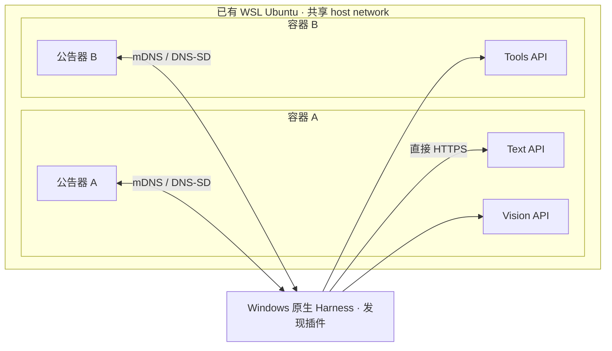

# 局域网 LLM API 服务发现 Demo 实施计划

- 版本：v0.5.0，点击展开的服务列表版，2026-11-03。
- 基线：[draft-cui-dawn-local-llm-api-discovery-00](https://datatracker.ietf.org/doc/draft-cui-dawn-local-llm-api-discovery/)。
- 客户端：现有 DeepSeek Harness Desktop 0.2.1-rc.3 / 0.2.1-rc.5。
- 用户确定的约束：**只有容器发布公告；Windows 只运行发现客户端。**
- 实际完成状态见 [验证报告](docs/validation-report.md)，不将计划项预先算作已验证。

## 1. 目标与范围

单台 Windows 电脑模拟两个节点、三个独立 LLM API。用户在 Harness 的“局域网服务”中发现候选、检查能力、点击连接并新建正常会话。入口来自真实网络发现。

所有模型均为 Mock，不需要 GPU、模型权重、云密钥或额度。发现、TLS、认证、HTTP/SSE、图像字节和工具结果回传必须真实发生。发现对象是 **LLM API 服务接口**，不是 Agent；服务端不规划任务、不执行客户端工具。

首版仅快速部署，不建立额外 VM、Hyper-V/VirtualBox 网络、多个独立 LAN IP 或 Office/Home 多网络实验。

## 2. 实测可行的拓扑



本机 Docker Desktop host networking 能打通 TCP，但没有打通所需 Windows↔容器 mDNS。因此使用已有 Ubuntu WSL，在其中启动专用临时 Docker Engine，Compose 容器使用 Linux host network。

- 不增加 VM，不修改 WSL 网络模式，不设置 Windows 代公告器、reflector 或推理网关。
- 专用 daemon、socket、数据目录，与用户其他 Docker 工作负载分离。
- 两个容器拥有独立文件系统和进程，**共享一个 WSL IP**，按端口和路径区分服务。这不是多个独立 LAN IP。
- 每个容器内部同时运行 API 与自己的公告器。
- Windows socket 绑定 ANY，并显式选择 WSL 虚拟网卡加入和发送组播。
- 自动读取 WSL 和 Windows 接口地址，不在公开配置中写死本机 IP。
- 首次下载依赖；缓存后构建和启动不需要模型或公网 API。

网络证据见 [网络验证](docs/network-spike.md)，操作见 [Windows 快速部署](docs/windows-quickstart.md)。

## 3. 默认服务与能力

| 节点 | 服务 | 端口 | base | 模型 | 能力 |
|---|---|---:|---|---|---|
| A | Text | 18443 | /text/v1 | mock-text | 文本输入/输出、SSE |
| A | Vision | 18443 | /vision/v1 | mock-vision | 文本/图像输入、文本输出、SSE |
| B | Tools | 28443 | /v1 | mock-tools | 文本、函数调用、工具结果回传、SSE |

每服务有独立 DNS-SD 实例、模型白名单、路径与认证策略，需要 key 的服务分别校验。A 的两项服务共享端口但可单独上下线，不能按 IP 合并服务。

展示层使用真实公开型号及模拟部署规格：A 为 DeepSeek-R1-Distill-Qwen-32B（Q4_K_M）与 Qwen2.5-VL-7B-Instruct（BF16），B 为 GLM-4-9B-Chat（INT4）。上述表格中的 `mock-*` 保留为请求 ID；服务条目和 Harness 模型菜单使用展示名。能力标签只突出图像、工具调用，文本和 SSE 不作为常规标签。字段、来源及 Mock 边界见 [模型展示说明](docs/model-presentation.md)。

默认三个服务同时支持流式及非流式响应。C 仅保留为独立 nonstream-only 测试夹具，不在默认 Compose 中，用来覆盖“发现成功、当前流式适配器不能接入”的兼容性区别。

- 图像 Mock 返回真实接收的字节数和 SHA-256，不声称理解图像。
- 函数调用由 API 生成，固定只读工具由 Harness 客户端执行，结果回传后才完成。
- 默认服务没有 web search。函数调用能力和机器能上网都不等于联网搜索能力。
- 模态、streaming、function_calling、server_tools 分开描述；支持/不支持/未知不混淆。
- 能力是经认证取得的服务声明，运行测试结果独立记录。
- 能力 JSON 使用实验接口，不放入 TXT，也不宣称是草案已有标准。

## 4. 发现到接入

1. 容器发布 _llm-api._tcp.local. 的 PTR、SRV、TXT 和地址记录。
2. 客户端仅由网络记录生成候选；独立信任文件不生成列表。
3. 检查版本、profile、scheme、auth、base。未知/无效记录保留诊断。
4. URL 由 scheme + SRV hostname/port + base 组成，不擅自添加 /v1。
5. 检查或连接时匹配独立授权，再读取 models 和 capabilities。
6. 固定连接发现且被允许的 IP，保留原 hostname 的 Host、SNI、CA 和主机名验证，再检查证书指纹。
7. 注册插件专用 Open Responses 适配器，Harness 直接向 API 发 HTTPS。
8. 按 revision 条件更新默认模型并新建会话；旧会话不迁移。

实现 TTL、goodbye 一秒宽限、cache-flush 分包保护、网络接口代次、名称探测/冲突和共享主机记录撤销。用独立 observer 交叉检查，但不宣称完整 RFC 6762/6763 一致性认证。

字段映射、限制与扩展见 [协议说明](docs/protocol-mapping.md)。

## 5. 独立仓库与实现模块

| 仓库 | 模块与职责 |
|---|---|
| llm-discovery-core | 可复用 mDNS 浏览、记录缓存、候选校验、事件与协议辅助函数 |
| llm-api-advertiser | 可复用服务公告库和 CLI：探测、公告、查询响应、每服务撤销 |
| dsh-lan-discovery | 独立 Harness 插件：双语原生侧栏、能力过滤、信任验证、配置事务、Responses 适配 |
| LLM_service_discovery（本仓库） | Demo 的 mock-api、lab-controller、Compose、网络与演示脚本、集成验证和文档 |

四个仓库采用 MIT 许可证，源码托管于 GitHub 的 `nobrowning` 账号下。可复用组件的维护源码从 Demo 分离；Demo 的 `packages/` 只保留 `mock-api` 和 `lab-controller`。发现核心库与公告器为 0.3.0，Harness 插件为 0.5.0，通过 `vendor/*.tgz` 和 lockfile 固定，单独取得 Demo 仓库即可 `npm ci`，不依赖兄弟目录或尚未发布的 npm 包。仓库关系、打包与更新步骤见 [独立仓库说明](docs/repositories.md)。

使用 JavaScript ESM，Node >=24 为当前完整复现基线。服务镜像仅包含所需服务代码与安装后的运行依赖，不含 Harness 或客户端 marker。

### 5.1 API 合同

- GET {base}/models
- GET {base}/_demo/capabilities
- POST {base}/responses
- TLS 是统一要求；DeepSeek 免 key，Qwen-VL/GLM 要求独立 Bearer key。GLM 通过演示准备保存一次 key，Qwen-VL 初始未配置。key 不在 DNS 中传播，免 key Open Responses 是草案绑定之外的实验扩展。
- 图像上限 5 MiB，请求体上限 8 MiB；不抓取外部图像 URL。
- 工具结果必须对应原 function_call 的 call_id；缺失/错误不能通过。
- 不实现真实推理、搜索、任意工具或服务器推理状态保存。
- 日志保留关联信息，不打印 token 或完整提示词。

### 5.2 Harness 接入

安装版本的内置 pi-ai 接口不能提供所需逐 provider CA/固定 DNS 解析，因此通过 ctx.llm.registerAdapter 实现小型客户端适配器，不修改已安装软件。

UI 使用真实 sidebar.panellist / main 扩展点，连接后调用 uiWorkspace.startSession。侧栏使用标准 same-origin `fetch`，Desktop 0.2.1-rc.3 shell 的 `forwardWebRequest` 负责向认证后的 Host 转发请求并保管 cookie，不依赖私有全局 transport hook。Host 通过 `ctx.connection.fetch.register` 注册八条精确控制路由；共享 registry 仅允许 owner Peer 调用，HTTP 载体先经过 Harness 的 Host/Origin 和认证检查。registry 缺失时注册失败，不另开 HTTP 控制入口。修改本地链接代码后，完全退出并重开 Desktop 才能同时重载 Host 与浏览器部分。

插件通过 Harness 官方 `locale` 服务注册中英文字典并订阅语言变化，覆盖侧栏和服务页面。优先使用 Harness 语言偏好；没有偏好时由 Harness 按系统语言选择。插件不自行修改系统语言或用户语言设置。独立源码仓库负责语言资源和构建，Demo 使用已打包插件；具体安装见 [插件说明](docs/plugin-setup.md)。实际语言切换与拆分后验收单独记录，不把实现计划算作已通过。

状态查询只接受 GET，控制变更只接受 POST JSON 对象，插件处理上限为 8 KiB。按操作校验允许字段与非空字符串类型，未知字段直接拒绝。接入请求引用当前已发现候选和经认证读取的模型目录；不接受请求指定 URL、信任或凭据文件路径。载体回归测试与实际 Desktop 会话验收分别记录，完成状态见验证报告。

路由按授权身份、地址和证书固定。默认模型通过 compare-and-set 更新；断开时仅在用户没有自行更改默认项的情况下恢复。其余 provider、旧会话及云凭据保留。

能力当前在明确检查/连接时刷新，UI 展示“能力待确认”及兼容性状态。不声称已实现能力自动 TTL 刷新或后台健康探测。

独立插件默认 `demoMode: false`，不注册演示用的 `demo_read_marker` 工具，也不附加 `demo_context_indices`。只有本 Demo 在 [插件配置](docs/plugin-setup.md) 中显式开启 `demoMode: true`，才启用这两项演示行为。

Harness 的部分宿主上下文也使用 user 角色。在 Demo 模式下，适配器仅依据已核对的精确 `source.kind` / `source.form` 组合 `time-context/snapshot`、`skill-catalog/catalog`、`agent-instructions/instructions`、`runtime-context/snapshot` 及同一运行时投影器已确认的无 form 清空分支，标记非空纯文本 user 消息，在标准请求 metadata 中附加实验性的 `demo_context_indices`，保留原始角色和全部文本。来源缺失、未知来源和普通用户的相同文字不标记。Mock 严格校验索引后，仅在回显、工具触发和新用户回合判定中排除这些上下文；不改变工具 call_id 验证。安装版全部 pre-step/user-message 生产路径已静态核对，其他条件性操作消息保留；Host 的脱敏请求诊断仅记录 role、producer kind/form 和实际工具名，便于核对真实调用，绝不记录正文、路径或凭据。该约定仅供本 Demo，不属于发现草案或通用 Open Responses 语义，详细边界、生产者核对和旧字段兼容规则见协议说明。

## 6. 信任与运行数据

初始化生成专用 CA、30 天服务证书、随机主机名、每服务 token 和本地 marker。

```text
.runtime/current/
  lab.json
  server/     # 唯一挂入容器的目录：服务配置、证书、私钥、token
  client/     # 不挂入容器：CA、trust.json、marker、恢复记录（无预填 key）
```

trust.json 匹配精确 URL、允许的地址、CA、证书 SHA-256 和独立认证策略。未知服务仍可发现，但不发送凭据。不修改系统信任库、不关闭 TLS 验证、不跨目标跟随重定向。

“一键接入”指已独立完成实验信任引导的服务，不能把点击发现结果解释成信任任意陌生服务。共享证书和服务配置挂载是 Demo 简化，不代表多租户隔离方案。

## 7. 部署与演示

```powershell
npm ci --ignore-scripts
npm test
.\scripts\doctor.ps1
.\scripts\start-demo.ps1
node scripts/verify-live.mjs
# 按 docs/plugin-setup.md 安装到现有 Desktop 的 desktop profile
# 打开“局域网服务”，检查能力，连接并新建会话
.\scripts\stop-demo.ps1
```

插件使用 Desktop 自带 CLI 安装 `vendor/dsh-lan-discovery-0.5.0.tgz`，不用其他 npm 版 dsh 改桌面 profile。日常部署不需要插件源码仓库；修改插件时在独立 `dsh-lan-discovery` 仓库构建、验证并更新安装包。具体命令和配置见 [插件安装说明](docs/plugin-setup.md)。

A Text 单独上下线使用容器 SIGUSR2，避开 Node 保留的 SIGUSR1。API readiness 驱动对应实例撤销和恢复，Vision 仍运行。

## 8. 实施顺序与验收

| 阶段 | 交付 | 门槛 |
|---|---|---|
| P0 网络 | 真实 Windows↔容器组播 | 读到 PTR/SRV/TXT/A 并按发现入口请求 |
| P1 服务 | 两节点三服务、TLS/能力 | 文本、图像、工具请求与回应 |
| P2 插件 | 原生侧栏、配置适配 | 实际 Harness 新会话接入和恢复 |
| P3 动态行为 | 单服务上下线、缓存失效 | A Text 撤销不影响 Vision；错误记录测试 |
| P4 展示与复现 | 脚本、独立 observer、文档 | 当前机器重复部署；第二台机器独立复现 |
| P5 可复用组件 | 四个独立仓库、版本化安装包、MIT、中英插件 | 单仓安装与打包检查、现有网络流程回归、实际 Harness 语言切换 |

必须分别记录自动测试、真实网络验证、实际桌面验证。适配器测试不能冒称桌面工具已执行；JSON 报文日志不能冒称完整 pcap；离线构建不能冒称已经物理断网演练。

现场讲解见 [IETF 演示流程](docs/demo-script.md)。重点证明多服务入口发现、能力差异与连接操作可实现，不把 Mock 能力当作模型质量证明。

## 9. 已知限制与后续工作

- Docker Desktop 本机组播路径失败，已改用已有 WSL 链路；其他机器需重新 doctor 与发现测试。
- WSL 重启可能改变 IP；地址不匹配时拒绝静默覆盖旧信任，创建新 runtime 后更新插件配置。
- Windows 防火墙提示由用户手动处理，脚本不修改规则。
- Desktop 当前支持 0.2.1-rc.3 / 0.2.1-rc.5，升级需重新验证。
- 未完成通用能力自动刷新、完整 RFC 一致性、IPv6 实机验证、跨子网发现。
- 本轮不建立多 VM、多 LAN IP、完整场景平台或通用真实模型兼容层。
- MIT 已选定；npm 或镜像发行前仍需完成第二台干净机器复现、发行包复核及版本发布。源码以四个独立 GitHub 仓库提供，并附复现文档。

## 10. 凭据保存与三种演示状态（0.4.0）

初始布局：DeepSeek 无需 key；GLM 已保存 key；Qwen-VL 尚未填写 key。先用 GLM 自己的本地合成 key 在服务条目验证并保存，再断开，Vision 保持未配置。展示已保存状态不把 key 填回密码框，也不自动连接。

输入 key 默认选择“记住 API key”；通过模型和能力接口验证后，插件使用 Harness 官方 credentials 服务保存。当前默认 provider 写入本地未加密 YAML，不是系统加密保险库，文档明确说明；取消勾选则仅本次运行使用。凭据按精确端点、证书、允许地址和认证策略绑定，不按服务名或 IP 共享。

普通断开保留已保存 key，退出后可恢复；清除会删除插件拥有的该服务凭据并撤销连接。错误替换不覆盖原先已验证 key。状态、恢复 journal、错误和发现公告不返回 key；保存失败必须显式反馈，不能显示为已保存。

Demo 演示者从本地 presenter/demo-api-keys.txt 取得随机 fixture，插件不自行读取此文件。旧四服务目录显式执行 migrate-three-state-demo，保留身份与私有材料，再重建两容器拓扑。迁移与演示详见 [API key 演示说明](docs/api-key-demo.md)。

### 历史版本

0.3.0/0.3.1 使用三节点四服务、两免 key 两需 key，用户输入只保留于单次 Harness 运行。该版本的测试和桌面记录作为历史证据保留，不能作为 0.4.0 的持久化与三服务验收。

## 11. 服务列表交互（0.5.0）

初始列表仅显示服务名称、地址、已知规格与特殊能力、凭据状态。点击条目后展开检查、连接和 key 管理，同一时间只展开一项；选择条目不自动请求 API 或接入。收起、切换或条目消失会清除未提交的密码。

取消统一的 Mock/已发现角标，只有已注册的服务路由显示已接入。服务明确声明 mock:true 时在展开详情显示模拟说明；缺少该声明不推断为真实模型。插件适用于真实服务，模拟能力仅由独立 Demo 提供。

本版本未更改服务端、核心库与公告器，继续使用 0.4.0 容器镜像和 0.3.0 核心/公告器。
