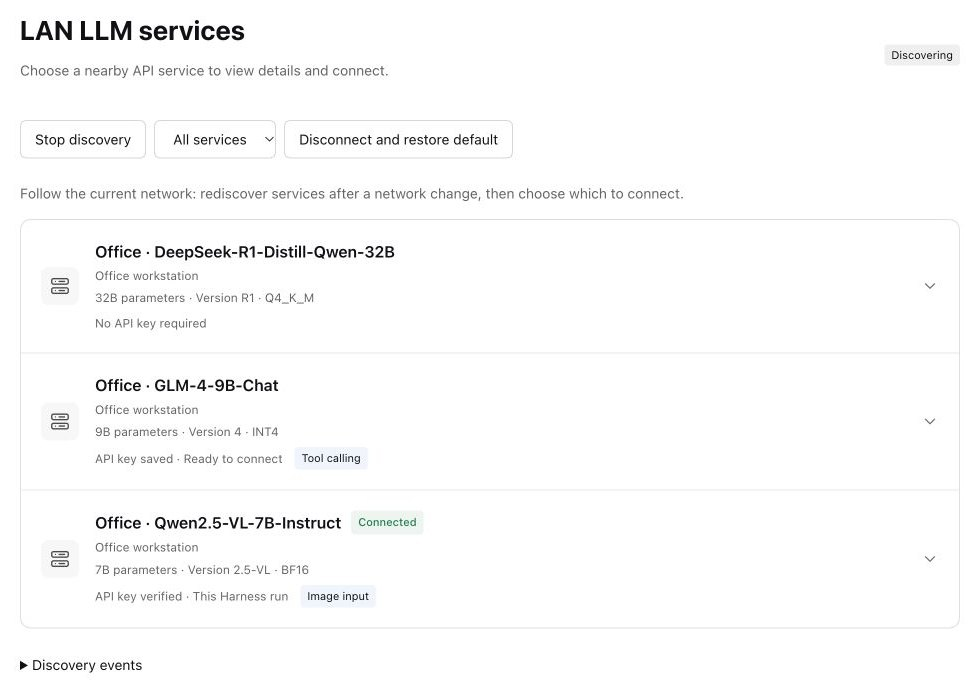

# Local LLM API Discovery · Demo

[中文](README.zh-CN.md) · [Website](https://nobrowning.github.io/llm-service-discovery-demo/) · [Technical details](https://nobrowning.github.io/llm-service-discovery-demo/technical.html)

Find the LLM APIs on your local network the way you find a printer. This repository is a runnable demo of the whole idea: model servers announce themselves, an AI app lists them, and you choose which one to use. It also holds the project website.



## Why

AI apps such as coding agents, chat apps and IDE assistants are front ends (harnesses) that send requests to an LLM API server. The model runs behind that API, so switching to another server is easy in principle. Finding the server is the hard part:

- Someone has to share the IP address, port, path and model name by hand.
- Every app on every device is set up separately.
- When the server moves, or your laptop joins another network, the settings stop working.

Printers and Wi-Fi solved this long ago: you look at what is available here and pick one. This project does the same for LLM APIs. Servers announce themselves with mDNS/DNS-SD under the service type `_llm-api._tcp`. Apps show the services on the network they are on right now. When the laptop moves to any other local network (office, home, a lab, a client site), the list is rebuilt for that network.

Discovery only shows options. Nothing connects until you choose a service, and every connection is checked over HTTPS against your own trust settings before a key is sent.

## What the demo includes

- Two nodes that announce three APIs on your LAN: a text model that needs no key, a vision model that needs a key, and a tool-calling model whose key you save once during setup.
- The DeepSeek Harness plugin, which lists the services and connects the one you choose to a normal conversation.
- Network profiles (`--scene company`, `--scene home`) that show the list changing when the laptop changes networks.

Discovery, HTTPS, authentication, streaming, image upload and tool calls are real. Model answers are simulated, so you need no GPU, model weights or cloud key. Model names are display labels only.

## Try it

You need Node.js 24 or later. Download `llm-service-discovery-demo-0.7.0-roaming.1-native.zip` from [Releases](https://github.com/nobrowning/llm-service-discovery-demo/releases), check it against `SHA256SUMS`, unzip it, and run from that folder:

```sh
node scripts/verify-release-files.mjs
node packages/lab-controller/cli.mjs list-interfaces
node packages/lab-controller/cli.mjs native run --runtime .runtime/native --interface YOUR_LAN_IPV4
```

Replace `YOUR_LAN_IPV4` with your address from the list and keep the terminal open. Then install the plugin from `vendor/` into Harness and open **LAN services**.

Step-by-step guides:

- [macOS with Harness Desktop](docs/mac-desktop-quickstart.md)
- [macOS, Linux or Windows, native processes](docs/native-quickstart.md)
- [Windows with two WSL containers](docs/windows-quickstart.md)
- [Install the Harness plugin](docs/plugin-setup.md) and [set up the three API key states](docs/api-key-demo.md)
- [All download, run and development details](docs/running.md) (English)

Most guides under `docs/` are written in Chinese.

## Project repositories

| Repository | What it does |
|---|---|
| [llm-api-advertiser](https://github.com/nobrowning/llm-api-advertiser) | Announces an LLM API on the local network. Runs next to the server. |
| [llm-discovery-core](https://github.com/nobrowning/llm-discovery-core) | Finds and checks announced services. A library for client apps. |
| [dsh-lan-discovery](https://github.com/nobrowning/dsh-lan-discovery) | Lists LAN services inside DeepSeek Harness and connects the one you choose. |
| **llm-service-discovery-demo** (this repository) | Runnable demo with simulated APIs, and the project website in [`website/`](website/). |

## Status

This is an experimental implementation of the IETF Internet-Draft [Discovery of LLM API Services in Local Networks](https://datatracker.ietf.org/doc/draft-cui-dawn-local-llm-api-discovery/) (draft-cui-dawn-local-llm-api-discovery-00). It uses IPv4 mDNS on one network interface at a time and only finds services on the same local network. It does not claim full RFC or draft conformance. What has been tested, and on which platforms, is in the [validation report](docs/validation-report.md).

## Develop

```sh
npm ci --ignore-scripts
npm test
node scripts/verify-components.mjs
```

More: [protocol mapping](docs/protocol-mapping.md), [repository boundaries](docs/repositories.md), [release notes](docs/release-notes.md), [five-minute demo script](docs/demo-script.md), [Mock API contract](packages/mock-api/README.md), [website source](website/README.md).

## License

[MIT](LICENSE). All four repositories use the MIT license.
