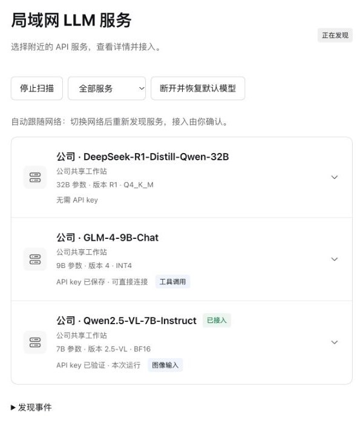

# 局域网 LLM API 发现 · Demo

[English](README.md) · [项目网站](https://nobrowning.github.io/llm-service-discovery-demo/?lang=zh) · [技术细节](https://nobrowning.github.io/llm-service-discovery-demo/technical.html?lang=zh)

像找打印机一样，找到局域网里的 LLM API。这个仓库是整套方案的可运行 Demo：模型服务主动公告自己，AI 应用把它们列出来，由你选择用哪一个。项目网站的源码也在这里。



## 为什么需要

编程 agent、聊天应用、IDE 助手这类 AI 应用，本质上是一个前端 harness，通过向 LLM API server 发送请求来工作。模型运行在 API 后面，所以换用另一个 server 本身并不难。难的是找到 server：

- 地址、端口、路径和模型名，都要有人手动发给你。
- 每台设备上的每个应用，都要单独配置一遍。
- 服务器换了地址，或者笔记本换了网络，原来的配置就失效了。

打印机和 Wi-Fi 早就解决了这个问题：先看这里有什么，再选一个。本项目把同样的方式用在 LLM API 上。服务通过 mDNS/DNS-SD 以 `_llm-api._tcp` 服务类型公告自己，应用显示当前所在网络里的服务。笔记本换到任何另一个局域网（公司、家、实验室、客户现场），列表都会按新网络重新建立。

发现只提供选项。你不选择，就不会接入任何服务；每次接入前，客户端都会按你自己的信任设置检查 HTTPS 连接，然后才发送 key。

## Demo 包含什么

- 两个节点在你的局域网中公告三个 API：一个无需 key 的文本模型，一个需要 key 的视觉模型，一个支持工具调用、在准备阶段保存一次 key 的模型。
- DeepSeek Harness 插件：列出这些服务，并把你选择的服务接入正常对话。
- 网络场景配置（`--scene company`、`--scene home`），用来展示笔记本换网络后列表的变化。

网络发现、HTTPS、认证、流式输出、图片上传和工具调用都是真实执行的；模型回答是模拟的，所以不需要 GPU、模型权重或云端 key。模型名称只是展示标签。

## 上手体验

需要 Node.js 24 或更新版本。在 [Releases](https://github.com/nobrowning/llm-service-discovery-demo/releases) 下载 `llm-service-discovery-demo-0.7.0-roaming.1-native.zip`，用 `SHA256SUMS` 核对后解压，在解压目录中运行：

```sh
node scripts/verify-release-files.mjs
node packages/lab-controller/cli.mjs list-interfaces
node packages/lab-controller/cli.mjs native run --runtime .runtime/native --interface YOUR_LAN_IPV4
```

把 `YOUR_LAN_IPV4` 换成列表里本机的局域网地址，并保持终端开启。然后把 `vendor/` 中的插件安装到 Harness，打开“局域网服务”。

分步指南：

- [macOS + Harness Desktop](docs/mac-desktop-quickstart.md)
- [macOS、Linux、Windows 原生进程](docs/native-quickstart.md)
- [Windows + 两个 WSL 容器](docs/windows-quickstart.md)
- [安装 Harness 插件](docs/plugin-setup.md)、[准备三种 API key 状态](docs/api-key-demo.md)
- [下载、运行与开发的全部细节](docs/running.zh-CN.md)

## 项目仓库

| 仓库 | 作用 |
|---|---|
| [llm-api-advertiser](https://github.com/nobrowning/llm-api-advertiser) | 在局域网中公告 LLM API，运行在服务端旁边。 |
| [llm-discovery-core](https://github.com/nobrowning/llm-discovery-core) | 发现并校验公告的服务，供客户端应用使用的库。 |
| [dsh-lan-discovery](https://github.com/nobrowning/dsh-lan-discovery) | 在 DeepSeek Harness 中列出局域网服务，并接入你选择的那个。 |
| **llm-service-discovery-demo**（本仓库） | 使用模拟 API 的可运行 Demo，项目网站源码在 [`website/`](website/)。 |

## 项目状态

本项目是 IETF 互联网草案 [Discovery of LLM API Services in Local Networks](https://datatracker.ietf.org/doc/draft-cui-dawn-local-llm-api-discovery/)（draft-cui-dawn-local-llm-api-discovery-00）的实验性实现。一次在一个网络接口上使用 IPv4 mDNS，只发现同一局域网内的服务，不声明完全符合 RFC 或草案。测试范围与平台见[验证报告](docs/validation-report.md)。

## 开发

```sh
npm ci --ignore-scripts
npm test
node scripts/verify-components.mjs
```

更多：[协议映射](docs/protocol-mapping.md)、[仓库分工](docs/repositories.md)、[发行说明](docs/release-notes.md)、[五分钟演示脚本](docs/demo-script.md)、[Mock API 接口](packages/mock-api/README.md)、[网站源码说明](website/README.md)。

## 许可

[MIT](LICENSE)。四个仓库均采用 MIT 许可。
