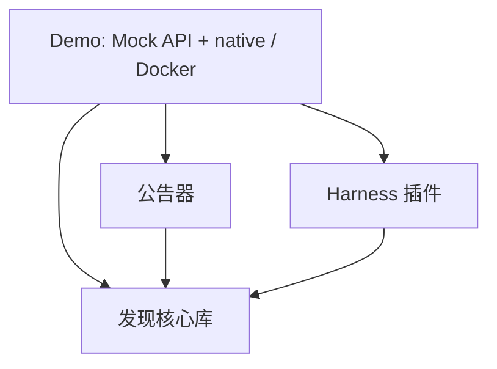

# 独立仓库与依赖

四个源码仓库均使用 MIT，托管在 GitHub 的 `nobrowning` 账号下。组件尚未发布到 npm registry 或镜像 registry。

| 仓库 | GitHub | 职责 |
|---|---|---|
| llm-discovery-core | [源码](https://github.com/nobrowning/llm-discovery-core) | 发现协议、记录校验、缓存和客户端生命周期；不依赖 Harness 或 Demo |
| llm-api-advertiser | [源码](https://github.com/nobrowning/llm-api-advertiser) | 可嵌入的公告库与 `llm-api-advertise` CLI，给已有 API 发布公告 |
| dsh-lan-discovery | [源码](https://github.com/nobrowning/dsh-lan-discovery) | 原生 Harness 页面、中文/英语、信任检查及 Responses 适配 |
| llm-service-discovery-demo | [源码](https://github.com/nobrowning/llm-service-discovery-demo) | Mock API、原生/容器三服务编排、IETF 演示与跨组件验收 |

每个仓库都可以独立克隆到任意目录。运行代码不依赖其他仓库的本机路径。

## 可独立安装的版本快照

Demo 候选版本为 `0.7.0-roaming.1`。发现核心库为 `0.4.0-roaming.1`，公告器为 `0.3.1`，Harness 插件为 `0.6.0-roaming.1`，尚未发布到 npm registry。为让每个仓库单独克隆即可安装，公告器和插件仓库分别携带各自固定版本的 core tgz（当前插件为 `0.4.0-roaming.1`），并在自己的 npm 安装包中 bundle core 及所需依赖。Demo 携带三个组件的 tgz，`package-lock.json` 固定文件和传递依赖。第三方依赖仍保留原始许可证。

四仓各自的 Releases 提供下载附件；普通体验者可使用 Demo 的 native ZIP（Node.js 原生运行），或 Windows/WSL ZIP（另带 linux/amd64 服务镜像）。只使用已有服务的 Harness 用户下载插件 tgz，服务提供者下载公告器 tgz，开发者使用核心库 tgz。发行包不带本机证书、API key 或用户 profile；每次首次部署在本机生成实验信任材料。

因此无需 npm scope 权限、父目录 workspace、兄弟目录链接、Git submodule 或在线临时拉取未发布的 core；正常执行 `npm ci --ignore-scripts` 即可。首次安装外部依赖仍需要 npm registry 或本地缓存。

## 开发与更新

各仓库分别执行 `npm ci --ignore-scripts` 和 `npm test`；插件还应执行 `npm run build`。组件源码只在各自仓库维护，Demo 中不再保留源码副本。

更新顺序是 core → 公告器/插件 → Demo。每次变更对外分发包时更新版本号，再执行 `npm pack`。把新版 core tgz 放入两个消费者的 vendor 并更新 package.json/lock；验证消费者后生成它们的包，再更新 Demo 的 vendor、package.json、lock 和 manifest。不要发布包含 `file:vendor/...` 的未审查配置到 registry；正式 npm 发布时改为已发布的精确版本依赖，重新验证产物。

组件测试分别归属自己的仓库。Demo 保留 Mock API 与插件/服务组合的集成测试；`scripts/verify-live.mjs` 和 `verify-lifecycle.mjs` 则验证真实原生或容器网络。各仓库 CI 只运行无组播网络需求的测试与打包检查。

初次拆分前的旧目录只保存在本机 `.runtime/migration-source-backup/`，不进入 Git、安装包或容器镜像。
